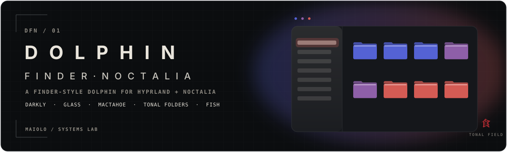
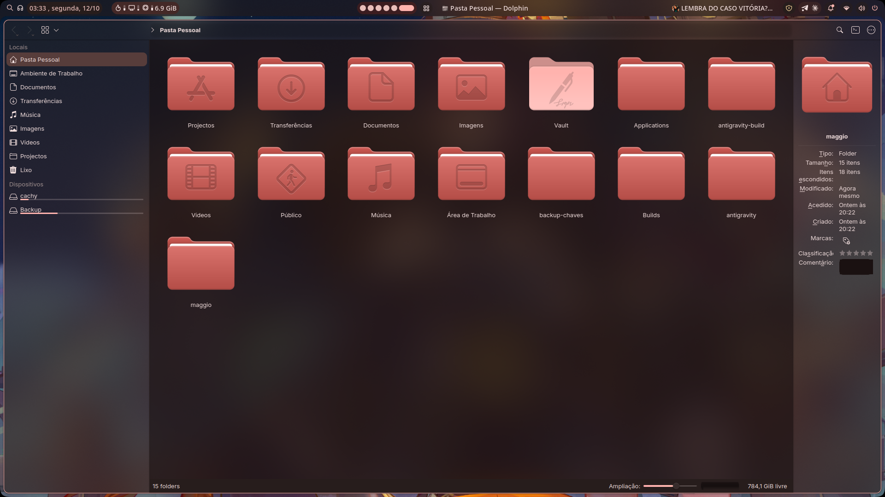
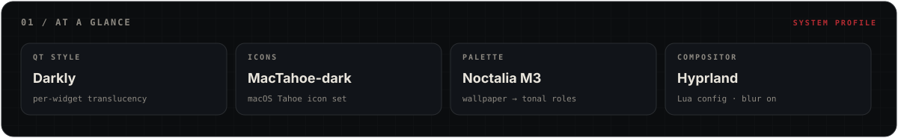
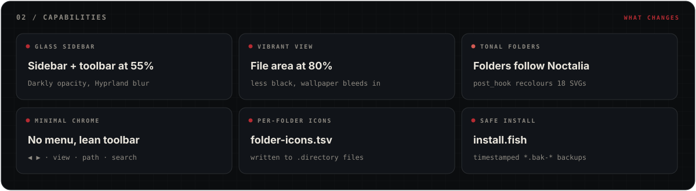
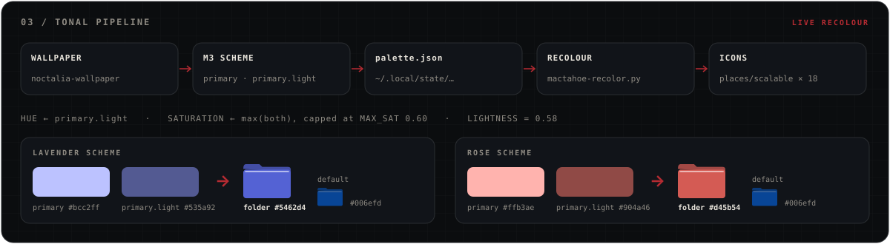
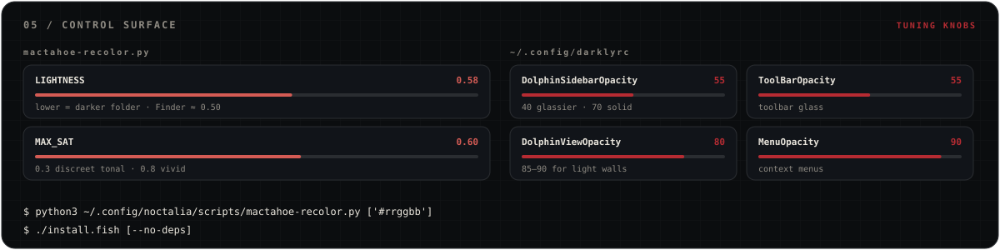
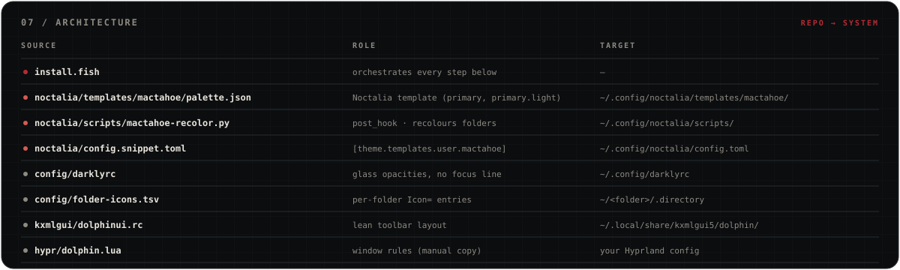
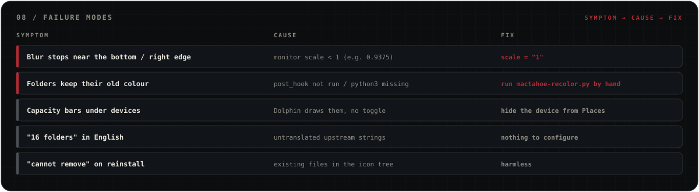
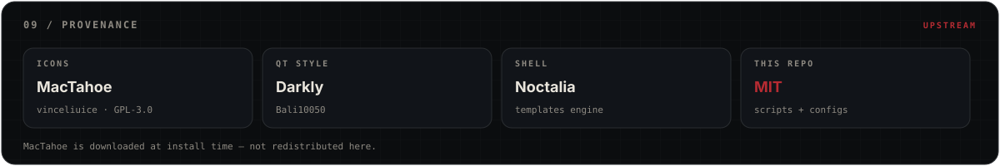

<p align="center">
  
</p>

<p align="center"><sub><strong>KDE DOLPHIN · DARKLY · MACTAHOE · HYPRLAND · NOCTALIA</strong></sub></p>

<p align="center">
  <a href="README.md">🇬🇧 English (UK)</a>
  · <a href="README.pt-br.md">🇧🇷 Português (BR)</a>
  · 🇵🇹 <strong>Português (PT)</strong>
  · <a href="README.es-es.md">🇪🇸 Español (ES)</a>
  · <a href="README.zh-cn.md">🇨🇳 简体中文</a>
</p>

> Dolphin com cara de **Finder do macOS** em **Hyprland + Noctalia**: barra lateral de vidro, ícones **MacTahoe** e pastas que **mudam de cor com o wallpaper**, seguindo a paleta tonal (Material You) do Noctalia.

<p align="center">
  
</p>

---

## 01 / VISÃO GERAL

<p align="center">
  
</p>

## 02 / CAPACIDADES

<p align="center">
  
</p>

| Peça | O que faz |
|---|---|
| **Darkly** (estilo Qt6) | Cantos arredondados; barra lateral e toolbar translúcidas, vidro subtil na área das pastas; sem linha de foco nem separadores |
| **MacTahoe-dark** (ícones) | Ícones estilo macOS Tahoe |
| **Template do Noctalia** + `mactahoe-recolor.py` | Sempre que o esquema muda, pinta as pastas com o tom principal do Noctalia |
| **dolphinrc / dolphinui.rc** | Sem menu, toolbar mínima (◀ ▶ · vista · caminho · pesquisa · terminal · menu), slider de zoom, ícones a 64 px |
| **Ícones de pastas** (`config/folder-icons.tsv`) | Ícones personalizados por pasta (ex.: `Vault → folder-sign`) |
| **Regras do Hyprland** (`hypr/dolphin.lua`) | Janela opaca (o vidro vem do Darkly) e diálogos a flutuar |

### O que acontece por baixo?

- A translucidez é desenhada pelo **Darkly**, widget a widget. O Hyprland mantém a janela em `opacity 1.0` e só faz blur onde o Darkly deixa passar.
- O Noctalia gera o `palette.json` a partir do esquema M3 a cada mudança de wallpaper/esquema e corre o `post_hook`.
- O hook reescreve os 18 SVG de pastas em `places/scalable` a partir dos originais azuis (`#006efd`) e limpa a cache de ícones do KDE.

## 03 / PIPELINE TONAL

<p align="center">
  
</p>

O matiz vem de `primary.light`, a saturação da mais viva das duas cores principais (com teto em `MAX_SAT`) e a luminosidade é fixa (`LIGHTNESS`). A pasta mantém o matiz do wallpaper sem ficar néon nem desbotada.

## 04 / INSTALAÇÃO

### Requisitos

- Arch / CachyOS (usa `paru` ou `yay`)
- Hyprland (config em Lua) com blur ligado
- Noctalia Shell com os templates `qt` e `kcolorscheme` ativos
- `qt6ct` como platform theme (`QT_QPA_PLATFORMTHEME=qt6ct`)
- `fish`, `git`, `python3`, `kwriteconfig6`

### Caminho rápido

```fish
git clone https://github.com/mastermaiolo/dolphin-finder-noctalia.git
cd dolphin-finder-noctalia
./install.fish
```

<details>
<summary><strong>O que o instalador faz</strong></summary>

1. instala `darkly`, `inter-font`, `git` e `python` (salta com `--no-deps`);
2. clona o [MacTahoe-icon-theme](https://github.com/vinceliuice/MacTahoe-icon-theme) e instala-o em `~/.local/share/icons`;
3. copia o template e o script de recoloração para `~/.config/noctalia/` e regista o template no `config.toml`;
4. aplica `darklyrc`, `qt6ct` (Darkly + MacTahoe-dark), `dolphinrc`, a toolbar e os ícones das pastas.

Antes de mexer num ficheiro faz sempre uma cópia (`*.bak-AAAAMMDD-HHMMSS`).

</details>

### Passos manuais

- copiar as regras de [`hypr/dolphin.lua`](hypr/dolphin.lua) para a tua config do Hyprland;
- usar `scale >= 1` no monitor (ver *08 / Problemas conhecidos*);
- no qt6ct, escolher a fonte **Inter 10**;
- fechar e voltar a abrir o Dolphin.

## 05 / SUPERFÍCIE DE CONTROLO

<p align="center">
  
</p>

Para aplicar a recoloração na hora:

```fish
python3 ~/.config/noctalia/scripts/mactahoe-recolor.py            # cor do Noctalia
python3 ~/.config/noctalia/scripts/mactahoe-recolor.py '#1a8fe8'  # cor fixa
```

## 06 / CONFIGURAÇÃO

**Cor das pastas:** no topo de `~/.config/noctalia/scripts/mactahoe-recolor.py`.

```python
LIGHTNESS = 0.58   # mais baixo = pasta mais escura (Finder ≈ 0.50)
MAX_SAT   = 0.60   # 0.3 = tonal discreto · 0.8 = vivo
```

**Vidro:** em `~/.config/darklyrc`.

| Chave | Valor | Efeito |
|---|---|---|
| `DolphinSidebarOpacity` | 55 | barra lateral (40 = mais vidro, 70 = mais sólido) |
| `ToolBarOpacity` | 55 | barra de ferramentas |
| `DolphinViewOpacity` | 80 | área das pastas (subir para 85–90 com wallpapers claros) |

<details>
<summary><strong>Bloco do template no Noctalia</strong></summary>

Acrescentado ao `~/.config/noctalia/config.toml` pelo `install.fish` (ou à mão a partir de `noctalia/config.snippet.toml`):

```toml
[theme.templates.user.mactahoe]
input_path = "$HOME/.config/noctalia/templates/mactahoe/palette.json"
output_path = "$HOME/.local/state/mactahoe-noctalia/palette.json"
post_hook = "python3 $HOME/.config/noctalia/scripts/mactahoe-recolor.py"
```

</details>

## 07 / ARQUITETURA

<p align="center">
  
</p>

```text
dolphin-finder-noctalia/
├── install.fish
├── config/
│   ├── darklyrc
│   └── folder-icons.tsv
├── hypr/
│   └── dolphin.lua
├── kxmlgui/
│   └── dolphinui.rc
├── noctalia/
│   ├── config.snippet.toml
│   ├── scripts/mactahoe-recolor.py
│   └── templates/mactahoe/palette.json
├── assets/readme/          # ilustrações do README
└── screenshots/
```

## 08 / PROBLEMAS CONHECIDOS

<p align="center">
  
</p>

<details>
<summary><strong>Notas detalhadas</strong></summary>

- **Blur cortado no fundo ou à direita da janela:** acontece com `scale` do monitor abaixo de 1 (ex.: `0.9375`). O Hyprland recorta o blur em `largura×scale` / `altura×scale`. Solução: `scale = "1"`.
- **Barras de capacidade nos dispositivos** da barra lateral: o Dolphin não tem opção para as esconder.
- **"16 folders" em inglês** na barra de estado: são frases que ainda não estão traduzidas no próprio Dolphin.
- **As pastas não mudam de cor:** o `post_hook` não correu ou falta o `python3` — corre o `mactahoe-recolor.py` à mão.
- **Instalar o MacTahoe outra vez** pode mostrar avisos `cannot remove`: não têm importância.

</details>

<details>
<summary><strong>Apêndice — desinstalar</strong></summary>

```fish
rm -rf ~/.local/share/icons/MacTahoe{,-dark,-light} ~/.local/share/mactahoe-noctalia
rm ~/.config/noctalia/scripts/mactahoe-recolor.py
rm -r ~/.config/noctalia/templates/mactahoe
```

Depois:

- remove o bloco `[theme.templates.user.mactahoe]` do `config.toml` do Noctalia;
- repõe os `*.bak-*` que quiseres.

</details>

## 09 / PROVENIÊNCIA

<p align="center">
  
</p>

- [MacTahoe-icon-theme](https://github.com/vinceliuice/MacTahoe-icon-theme), de vinceliuice — descarregado durante a instalação, não vem incluído aqui.
- [Darkly](https://github.com/Bali10050/Darkly) — estilo Qt.
- [Noctalia](https://noctalia.dev) — shell e motor de templates.

## 10 / LICENÇA

- Scripts e configs deste repositório: [MIT](LICENSE).
- MacTahoe-icon-theme: GPL-3.0 (licença do projeto original).

---

<p align="center"><sub>MAIOLO / SYSTEMS LAB · DFN</sub></p>
